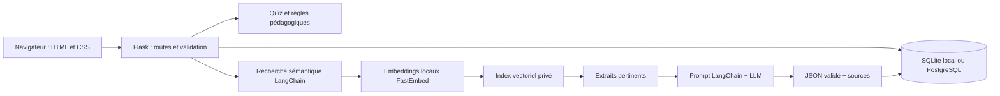

# AdaptLearn AI — comprendre et vérifier le projet

## 1. Ce qui a changé dans cette version

Le studio utilise maintenant **un RAG sémantique avec LangChain**, des embeddings neuronaux multilingues locaux et un LLM. L’ancien TF-IDF et les supports extractifs de démonstration ont été retirés.

Le code est organisé autour d’un chemin principal : chercher les extraits utiles, les transmettre au LLM, vérifier sa réponse puis la sauvegarder avec les sources. Les imports de documents et les appels au service IA sont séparés des routes pour faciliter la lecture.

Les comptes, profils, cours, quiz, statistiques et anciennes productions sont conservés. Les anciens scores de recherche sont identifiés comme historiques.

## 2. Utiliser l’application

```bash
python3 -m venv .venv
source .venv/bin/activate
pip install -r requirements.txt
python scripts/download_model.py
python -m flask --app app run --port 5050
```

Ouvrir http://127.0.0.1:5050, créer un compte puis compléter son profil. Les comptes et les quiz des cours fonctionnent sans IA. Le studio nécessite un LLM configuré et télécharge le modèle d’embeddings à son premier usage.

Pour utiliser Ollama installé sur la machine :

```bash
ollama pull qwen2.5:1.5b
```

Ollama doit être démarré. Créer `.env` à la racine :

```dotenv
AI_MODE=llm
LLM_BASE_URL=http://127.0.0.1:11434/v1
LLM_API_KEY=ollama
LLM_MODEL=qwen2.5:1.5b
```

La valeur `ollama` est une convention du client compatible OpenAI, pas une clé payante. Pour un fournisseur distant, remplacer URL, clé et modèle. Le fournisseur doit prendre en charge les sorties JSON structurées utilisées par le client. Redémarrer Flask après modification.

Le guide [docs/RAG.md](docs/RAG.md) détaille les paramètres, les modèles, les sources et les tests. Les essais de livraison sont décrits dans [docs/VERIFICATION.md](docs/VERIFICATION.md).

## 3. Le fonctionnement global



**Flask** reçoit les demandes du navigateur. **Jinja** produit les pages HTML. **SQL** conserve les données. **LangChain** relie les étapes du RAG. Les fonctions pédagogiques restent indépendantes du LLM.

## 4. Les fichiers à lire, dans l’ordre

| Fichier | Contenu | Exemple de modification |
| --- | --- | --- |
| `courses.py` | Les cinq leçons Python, questions et prérequis | Corriger une question ou ajouter un cours |
| `pedagogy.py` | Correction, adaptation, recommandations et statistiques | Modifier le seuil de maîtrise |
| `learning.py` | Routes des cours, quiz, résultats et suivi | Changer le parcours après un quiz |
| `database.py` | Création des tables et requêtes SQL paramétrées | Ajouter un champ ou une sauvegarde |
| `auth.py` | Inscription, connexion, déconnexion et CSRF | Modifier les règles du nom d’utilisateur |
| `retrieval.py` | Découpage, embeddings, index et recherche sémantique | Ajuster le seuil de similarité |
| `generation.py` | Prompt LangChain, appel du LLM et validation JSON | Modifier les consignes pédagogiques |
| `studio.py` | Routes : documents, génération, consultation, export | Modifier le parcours du studio |
| `document_import.py` | Lecture et validation texte/PDF | Ajouter un format de document |
| `ai_client.py`, `ai_service.py` | Communication avec le service IA séparé optionnel | Modifier son délai ou son authentification |
| `app.py` | Configuration, initialisation, accueil et profil | Définir une variable d’environnement |
| `templates/`, `static/style.css` | Pages et présentation | Modifier un texte, une couleur ou une disposition |

## 5. Exemple : création d’un compte

```text
Formulaire d’inscription
  → auth.py valide le nom et le mot de passe
  → le mot de passe est haché
  → database.create_user() exécute INSERT INTO users
  → connect() valide la transaction avec commit()
```

Le nom d’utilisateur est unique et enregistré en minuscules. Le prénom du profil ne doit pas être unique. Un UUID identifie le compte ; les résultats et documents sont associés à cet identifiant.

En cas d’erreur SQL, la transaction est annulée avec `rollback()`. Les paramètres des requêtes sont séparés du SQL. Chaque lecture privée utilise l’identifiant du compte connecté.

## 6. Quiz, adaptation et recommandations

Chaque cours dispose d’un quiz éditorial de quatre questions. Le serveur exige exactement une réponse valide par question, calcule le score et sauvegarde la tentative.

```text
pourcentage = 100 × bonnes réponses / nombre de questions
```

Le seuil est `MASTERY_PERCENTAGE = 70.0` dans `pedagogy.py`. Avec quatre questions, il faut au moins trois bonnes réponses, soit 75 %.

Le parcours retient le **dernier score** de chaque cours. Si le seuil est atteint, le cours est maîtrisé ; sinon il est à revoir. La prochaine leçon conseillée doit avoir ses prérequis maîtrisés. Les leçons restent consultables librement : le parcours est un conseil, pas un verrou d’accès.

Les recommandations donnent priorité aux révisions, puis à la prochaine leçon. Le niveau déclaré et les mots de l’objectif affinent le classement. Cette adaptation est un système de règles explicites, sans modèle entraîné sur des apprenants.

Les quiz générés par le LLM sont des entraînements séparés : ils apparaissent dans l’historique mais ne modifient pas la maîtrise des cours éditoriaux.

## 7. Le vrai RAG, étape par étape

1. **Charger le corpus autorisé** : les documents du compte, les leçons ou les deux.
2. **Découper les textes** avec le splitter LangChain, en respectant la capacité du modèle.
3. **Calculer les embeddings** : FastEmbed transforme chaque passage en vecteur numérique représentant son sens.
4. **Construire ou charger l’index vectoriel** LangChain. Une empreinte permet de repérer les changements de corpus.
5. **Encoder la question**, puis rechercher les passages par similarité cosinus. Jusqu’à quatre passages dépassant le seuil sont retenus.
6. **Construire le prompt** : sujet, format attendu et extraits numérotés `[1]`, `[2]`…
7. **Appeler le LLM via ChatOpenAI** pour rédiger le support.
8. **Valider et sauvegarder** le JSON et une copie des sources utilisées.

La composition du prompt et du modèle est visible dans `generation.py`. Le téléchargement du modèle d’embeddings est public ; les documents sont encodés localement. Seuls les passages choisis sont transmis au fournisseur du LLM configuré.

Le modèle d’embeddings ne rédige pas de réponse. Le LLM ne choisit pas lui-même les documents auxquels le compte a accès. LangChain organise ces opérations.

### Réglages principaux

| Variable | Rôle |
| --- | --- |
| `EMBEDDING_MODEL` | Modèle neuronal multilingue utilisé pour les vecteurs |
| `EMBEDDING_CACHE_DIR` | Cache local des fichiers du modèle |
| `RAG_INDEX_DIR` | Répertoire des index privés |
| `RAG_MIN_SCORE` | Seuil de similarité, initialement 0.35 |
| `LLM_BASE_URL` | Adresse de l’API de génération |
| `LLM_API_KEY` | Clé privée ou valeur conventionnelle Ollama |
| `LLM_MODEL` | Modèle de génération choisi |
| `LLM_TIMEOUT` | Délai d’appel du fournisseur |

Le seuil de recherche est un réglage initial à évaluer sur les documents du projet. Un score de 0.8 ne signifie pas « 80 % de chances que la réponse soit correcte ».

Le prompt demande des citations et le contrôle rejette les références numériques hors des extraits fournis. Cela ne vérifie pas automatiquement que chaque phrase découle réellement de sa source. La relecture pédagogique reste nécessaire.

## 8. Stockage et confidentialité

| Table | Données |
| --- | --- |
| `users` | Compte et mot de passe haché |
| `learner_profiles` | Pseudonyme, niveau et objectif |
| `attempts` | Scores, réponses et corrections |
| `documents` | Titres et textes importés |
| `generations` | Supports, sujet, mode et extraits sources |

En local, la base est `instance/adaptlearn.sqlite`. Les modèles et les index sont également dans `instance/`. Ce dossier et `.env` sont exclus de Git.

Les index sont séparés par compte et périmètre de recherche. Une modification du corpus invalide leur empreinte. L’import et la suppression purgent les index personnels concernés. Une recherche déjà démarrée peut encore travailler sur son instantané : ce prototype ne garantit pas un effacement physique instantané en concurrence.

Les productions existantes gardent une copie de leurs extraits même après suppression d’un document : cela permet de relire leurs sources. Les fichiers binaires PDF originaux ne sont pas conservés. Les dates sont enregistrées en UTC.

Limites d’import : 1 Mio, 50 000 caractères extraits, 30 documents par compte. Les PDF scannés sans texte nécessitent un OCR externe.

## 9. Ce que mesurent les statistiques

La moyenne est calculée sur les pourcentages de toutes les tentatives éditoriales. Le dernier score décrit l’essai le plus récent ; le meilleur score est le maximum. La maîtrise du catalogue est le nombre de cours maîtrisés divisé par cinq.

Aucun temps d’étude ou niveau cognitif n’est inventé à partir de ces résultats. Les petits quiz ne suffisent pas à prouver une maîtrise générale de Python.

## 10. Déployer et tester

Le mode local utilise Flask et SQLite. Le mode Docker sépare le web, le service IA et PostgreSQL. Un volume conserve les index et les modèles ; un autre conserve PostgreSQL. Le guide [docs/DEPLOIEMENT.md](docs/DEPLOIEMENT.md) explique la configuration cloud et HTTPS. Aucune VM publique n’est provisionnée par le code.

```bash
python -m unittest discover -s tests -v
RUN_SEMANTIC_TESTS=1 python -m unittest discover -s tests -p test_semantic_integration.py -v
python scripts/verify_rag.py
```

Les tests rapides injectent des doubles explicites pour éviter les téléchargements et les appels payants. Le test sémantique exécute le vrai modèle multilingue. Le script final utilise le véritable LLM configuré et sauvegarde le résultat dans `instance/rag-verification.json`.

La CI couvre Python 3.12/3.14, PostgreSQL, Docker et une intégration avec le modèle multilingue. Le fournisseur factice de `compose.test.yaml` sert uniquement à tester le transport et le contrat dans la CI.

## 11. Ta liste de vérification

- [ ] Créer deux comptes et vérifier l’isolation des profils, documents et résultats.
- [ ] Relire les cinq leçons et les vingt questions éditoriales.
- [ ] Vérifier le score d’un quiz puis le changement du parcours.
- [ ] Comparer la moyenne, le dernier score et le meilleur score à l’historique.
- [ ] Importer du texte et un PDF textuel.
- [ ] Poser une question reformulée avec des synonymes et vérifier les passages retrouvés.
- [ ] Générer un résumé, des fiches et un quiz avec le LLM configuré.
- [ ] Relire la qualité des contenus, des distracteurs et des références aux sources.
- [ ] Vérifier qu’un quiz généré reste séparé de la maîtrise des cours.
- [ ] Exporter le JSON et vérifier l’absence du corrigé du quiz.
- [ ] Vérifier la lisibilité sur un petit écran.

| Fichier ou page | Problème observé | Correction souhaitée | Priorité |
| --- | --- | --- | --- |
|  |  |  |  |
|  |  |  |  |
|  |  |  |  |

Ce projet reste un prototype académique : il manque notamment la récupération de mot de passe, les rôles enseignants, une limitation distribuée des connexions et des dépenses LLM, un traitement PDF isolé et des migrations versionnées du schéma avant une exploitation publique durable.
