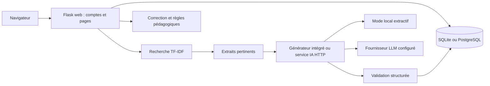

# AdaptLearn AI — document de vérification et de correction

Date : 22 novembre 2026. Ce document décrit la version complète du prototype pédagogique, après les huit étapes de la conception initiale. Il sert à comprendre le code, préparer la présentation et noter les corrections souhaitées.

## 1. Ce que fait le projet

AdaptLearn AI accompagne un apprenant dans un petit parcours Python. Il conserve son profil, propose des leçons, corrige ses quiz et recommande la suite selon les résultats. L’apprenant peut aussi importer ses propres documents pour produire un résumé, des fiches ou un quiz de révision.

Deux modes de création de supports sont disponibles :

- **Local extractif** : sélection de phrases et exercices à trous à partir des textes, sans LLM et sans clé. C’est le mode de démonstration par défaut.
- **LLM** : les passages retrouvés et la requête sont envoyés au modèle du fournisseur configuré. La réponse structurée est contrôlée avant d’être enregistrée.

Le parcours et les recommandations reposent sur des règles explicites, faciles à expliquer. Ils ne constituent pas un modèle d’apprentissage automatique entraîné sur des apprenants. La recherche documentaire repose sur TF-IDF, sans embeddings ni base vectorielle.

## 2. État des huit étapes

| Étape | Réalisation | Comment la vérifier |
| --- | --- | --- |
| 1. Socle | Profil, catalogue, sauvegarde SQL | Créer un profil et redémarrer l’application |
| 2. Évaluations | Cinq quiz éditoriaux de quatre questions, correction et historique | Passer un quiz et ouvrir son résultat |
| 3. Adaptation | Maîtrise selon dernier score et prérequis | Comparer le parcours après un échec puis une réussite |
| 4. Génération | Résumés, fiches, quiz locaux et connecteur LLM | Produire les trois formats et regarder le mode affiché |
| 5. RAG | Import, segmentation, recherche lexicale, contexte transmis et extraits conservés | Importer un texte et chercher un de ses thèmes |
| 6. Recommandations | Priorité aux révisions, à la prochaine leçon, au niveau et à l’objectif | Lire les raisons sur la page Ressources |
| 7. Analytics | Tentatives, moyenne, derniers/meilleurs scores, maîtrise et évolution | Comparer le tableau de bord aux résultats réels |
| 8. Industrialisation | Comptes, isolation, CSRF, PostgreSQL, web et service IA séparables, Docker Compose, CI et guide cloud | Tests automatiques et procédure de déploiement |

La dernière étape fournit une architecture exécutable et une procédure cloud. Aucune VM cloud publique n’a été provisionnée. Aucun appel réel à un fournisseur LLM payant n’a été effectué : le connecteur est testé avec un fournisseur HTTP factice.

## 3. Installation et lancement

### 3.1 Version locale : la plus simple à présenter

Depuis le dossier du projet :

```bash
python3 -m venv .venv
source .venv/bin/activate
pip install -r requirements.txt
python -m flask --app app run --port 5050
```

Ouvrir http://127.0.0.1:5050. Créer un compte, compléter le profil, consulter les leçons et utiliser le studio. Arrêter avec `Ctrl+C`. Pour relancer, réactiver l’environnement et répéter la commande Flask.

Les données sont créées automatiquement dans `instance/adaptlearn.sqlite`. Une clé de session locale est créée dans `instance/secret.key`. Ces fichiers ne sont jamais poussés sur GitHub. Les identifiants et mots de passe sont choisis lors de l’inscription ; il n’existe pas de compte administrateur prédéfini.

La version 0.1 utilisait une table `profile` partagée. Elle est conservée dans une base existante pour éviter de perdre les données. Elle n’est pas attribuée automatiquement à un nouveau compte : créer son profil personnel après inscription. Les nouvelles tables sont ajoutées sans effacer cette table historique.

### 3.2 Activer un vrai LLM

Créer un fichier `.env` à la racine, exclu de Git :

```dotenv
AI_MODE=llm
LLM_BASE_URL=https://api.openai.com/v1
LLM_API_KEY=votre-cle-privee
LLM_MODEL=identifiant-du-modele-de-votre-fournisseur
LLM_TIMEOUT=45
```

Le connecteur utilise `POST /chat/completions` avec `response_format=json_object`. Le modèle choisi doit accepter ce contrat. `LLM_BASE_URL` désigne la racine jusqu’à `/v1`, sans `/chat/completions`. Un fournisseur compatible local peut utiliser une URL HTTP sur votre machine et les identifiants qu’il exige.

Redémarrer le serveur. Le mode affiché sur une nouvelle production doit être « LLM ». En cas d’erreur, vérifier le modèle, la clé, l’URL et le délai. Le projet ne remplace pas une génération échouée par du texte local sans l’indiquer. Les anciennes productions gardent le mode de leur création.

Seuls la requête et les titres/extraits choisis sont envoyés au fournisseur ; le mot de passe et les résultats de l’apprenant ne font pas partie du prompt. Vérifier que les documents peuvent être transmis au fournisseur choisi avant d’activer ce mode.

### 3.3 Version distribuée et PostgreSQL

Le guide [docs/DEPLOIEMENT.md](docs/DEPLOIEMENT.md) explique les secrets, Docker Compose, HTTPS, sauvegardes et mises à jour. La pile comprend :

1. **Web** : Flask et Gunicorn, pages, comptes, stockage et orchestration.
2. **IA** : service Flask indépendant, recherche déjà effectuée côté web puis génération locale ou LLM. Appel protégé par un jeton partagé.
3. **Base** : PostgreSQL 17 et volume persistant.

Seul le port web `127.0.0.1:5050` est publié. Les ports PostgreSQL et IA ne sont pas exposés sur l’hôte. Le cloud utilise cette même pile sur une VM, avec un proxy HTTPS devant le web.

Pour utiliser PostgreSQL sans Compose : installer `requirements-deploy.txt`, fournir une `DATABASE_URL` PostgreSQL valide et lancer le serveur. Le schéma est créé automatiquement. Le passage de SQLite à PostgreSQL **ne copie pas les anciennes données** ; une reprise de données demande un export/import spécifique.

## 4. Comprendre l’architecture



Les modèles HTML sont rendus sur le serveur par Jinja. Il n’y a pas de frontend React ni de JavaScript à apprendre pour cette version. Les fonctions de calcul restent séparées des routes HTTP.

| Fichier | Responsabilité | Où intervenir pour corriger |
| --- | --- | --- |
| `app.py` | Configuration, accueil, profil, initialisation, santé et erreurs | Variables d’environnement, champs profil, connexion des modules |
| `auth.py` | Inscription, connexion, déconnexion, session et CSRF | Règles de compte et protection des routes |
| `database.py` | Connexions et requêtes SQL paramétrées | Schéma et persistance |
| `courses.py` | Contenu des cinq leçons, questions et prérequis | Cours, bonnes réponses et explications |
| `pedagogy.py` | Correction, maîtrise, parcours, recommandations et statistiques | Seuil, règles d’adaptation et calculs |
| `learning.py` | Routes des leçons, quiz et pages de suivi | Navigation et traitement des réponses |
| `retrieval.py` | Découpage et score de recherche | Taille des passages et pertinence |
| `generation.py` | Extraction locale, appel LLM et validation | Prompt, contrats JSON et qualité des exercices |
| `ai_service.py` | API indépendante de génération | Authentification du service et limites HTTP |
| `studio.py` | Import, recherche, sauvegarde, export et quiz générés | Formats des fichiers et flux du studio |
| `templates/` | Pages HTML | Texte, disposition et formulaires |
| `static/style.css` | Apparence et adaptation aux petits écrans | Couleurs, typographie et mise en page |
| `tests/` | Scénarios vérifiables | Ajouter une régression avant un correctif |
| `Dockerfile`, `compose.yaml` | Exécution conteneurisée | Ports, processus, services et volumes |
| `.github/workflows/tests.yml` | Vérifications sur GitHub Actions | Versions Python et services de test |

## 5. Données enregistrées

Les identifiants sont des UUID sous forme de texte. Les dates sont enregistrées en UTC au format ISO. Les productions comportent des champs JSON stockés dans des colonnes texte, pour conserver une structure simple compatible SQLite/PostgreSQL.

| Table | Informations principales | Propriétaire |
| --- | --- | --- |
| `users` | Nom de compte normalisé, mot de passe haché, date de création | Compte lui-même |
| `learner_profiles` | Pseudonyme, niveau, objectif | `user_id` |
| `attempts` | Cours ou production évaluée, score, total, réponses et correction | `user_id` |
| `documents` | Titre et texte extrait, date d’import | `user_id` |
| `generations` | Sujet, format, mode, support JSON, copie des extraits et date | `user_id` |

Une tentative doit cibler **un cours ou un quiz généré**, jamais les deux. Le code vérifie la propriété des quiz générés avant l’écriture. Les nouvelles tables imposent aussi la cohérence des scores et du type d’évaluation.

Supprimer un document enlève le document du corpus de recherche. Cela ne supprime pas les productions existantes ni leurs extraits copiés : ces extraits permettent de comprendre sur quoi une ancienne production reposait. Il n’y a pas encore d’écran de suppression de compte ou de production.

Une base NoSQL n’est pas nécessaire à cette échelle : SQL stocke les relations et les champs JSON stockent les supports. L’ajout d’une base supplémentaire demanderait un besoin concret, par exemple un grand corpus documentaire partagé.

## 6. Quiz et correction

Chaque cours contient quatre questions éditoriales, chacune avec quatre choix et une réponse correcte. Les indices des réponses vont de 0 à 3 dans le code et de 1 à 4 dans le résultat présenté.

Au chargement du formulaire, seules les questions et les options sont envoyées au navigateur. À la validation, le serveur exige exactement une réponse valide par question. Le score n’est jamais accepté depuis un champ envoyé par le navigateur.

```text
score = nombre de réponses correctes
pourcentage = 100 × score / nombre de questions
```

Une tentative valide est conservée avec la correction. Une soumission incomplète, multiple ou hors des choix autorisés est refusée sans créer de tentative. Les anciens résultats restent consultables par leur propriétaire.

Les quiz du studio utilisent la même fonction de correction. Ils constituent des entraînements : ils figurent dans l’historique, mais ils ne changent pas la maîtrise des cours éditoriaux. Cela évite qu’une question générée de qualité variable modifie directement le parcours de référence.

## 7. Parcours adaptatif et recommandations

Le seuil de maîtrise est défini par `MASTERY_PERCENTAGE = 70.0` dans `pedagogy.py`.

1. Trier les tentatives par date et retenir le dernier résultat de chaque cours.
2. Marquer comme maîtrisé un cours dont le dernier score atteint 70 %.
3. Chercher les prérequis non maîtrisés de chaque cours.
4. Conseiller la première leçon accessible encore à maîtriser, ou sa révision après un score insuffisant.
5. Ajouter une explication liée au dernier score, aux prérequis et au niveau déclaré.

Avec quatre questions, les scores possibles sont 0, 25, 50, 75 et 100 %. Le seuil de 70 % revient donc à réussir au moins trois questions sur quatre.

Les prérequis guident les conseils. Ils ne bloquent pas l’accès aux leçons : un apprenant peut consulter un cours en avance et passer son quiz. Un cours déjà réussi reste affiché comme maîtrisé même si un prérequis est ensuite à revoir ; cette règle est volontairement simple et peut être revue selon la méthode pédagogique choisie.

Les ressources sont classées par priorité : révision, prochaine leçon, autres leçons accessibles, puis suggestions futures pertinentes. Le niveau et les mots de l’objectif affinent le classement. Ce mécanisme est une recommandation à règles et contenu, sans filtrage collaboratif ni historique d’autres utilisateurs.

## 8. Recherche documentaire et RAG

L’import accepte : texte collé, `.txt`/`.md` UTF-8 ou PDF textuel. Le texte est extrait et stocké ; le fichier binaire original n’est pas conservé. Les PDF protégés par mot de passe et ceux sans texte extractible sont refusés. Il n’y a pas d’OCR.

Limites : 1 Mio par fichier, 50 000 caractères de texte par document, 30 documents par compte. Le quota de documents est vérifié dans une transaction pour éviter que deux imports simultanés le dépassent.

Pour chaque génération :

1. Sélectionner le corpus : leçons, documents personnels ou les deux.
2. Découper les textes en passages de 1 200 caractères au maximum, avec chevauchement.
3. Normaliser les mots : casse, accents, mots vides et pluriels simples.
4. Calculer les vecteurs TF-IDF et leur similarité cosinus avec la requête.
5. Garder au maximum quatre passages pertinents. Un titre sert à pondérer, mais ne suffit pas si aucun mot recherché ne figure dans le passage.
6. Générer le support à partir de ces passages et conserver une copie des sources.

Le score affiché mesure la proximité lexicale, pas la confiance dans la vérité du contenu. La recherche peut manquer des synonymes ou des reformulations. Si aucun passage ne correspond, l’application demande de reformuler au lieu de créer un contenu sans contexte.

En mode LLM, cette chaîne est un RAG lexical : récupération d’un contexte documentaire, puis génération conditionnée par ce contexte. En mode local, il s’agit d’une récupération suivie d’une transformation extractive, sans génération par modèle de langage.

## 9. Génération et service IA

Le générateur produit un objet structuré :

| Format | Champs spécifiques |
| --- | --- |
| Résumé | `content` : texte synthétisé ou extraits sélectionnés |
| Fiches | `cards` : liste de `front` et `back` |
| Quiz | `questions` : énoncé, quatre choix, indice de réponse et explication |

Tous les formats contiennent `kind`, `mode` et `title`. La validation refuse les champs inattendus, types incorrects, textes trop longs, choix dupliqués et indices de réponse invalides. Les sorties non encodables en UTF-8 ou contenant un caractère nul sont refusées avant l’enregistrement.

Le mode local sélectionne des phrases pour les résumés. Les fiches transforment un terme et son passage en question/réponse. Les quiz masquent un terme de la phrase et proposent des distracteurs issus du vocabulaire. Ces exercices ont une qualité limitée et nécessitent une relecture ; ils ne sont pas équivalents à une conception pédagogique experte.

Le mode LLM construit un prompt système qui impose le format et considère les documents comme des données non fiables. Les réponses restent du texte échappé dans les pages, sans HTML exécuté. Cette protection de format ne démontre pas la justesse des faits ni l’absence de toute influence des documents sur le modèle.

Le service IA indépendant expose :

- `GET /health` : disponibilité du processus.
- `POST /generate` : objet JSON `kind`, `query`, `sources`, avec en-tête `Authorization: Bearer <jeton>`.

Limites : 200 Kio de requête, 16 extraits maximum côté service, sortie fournisseur limitée à 128 Kio et délai fournisseur configurable. Les redirections HTTP ne sont pas suivies pour éviter de transférer le jeton à une autre destination. Un refus métier est distingué d’une panne du service. Le service ne contient pas les comptes ni la base des apprenants.

## 10. Analytics : sens exact des chiffres

- **Tentatives sur les cours** : nombre d’évaluations éditoriales envoyées avec des réponses valides.
- **Moyenne** : moyenne arithmétique des pourcentages de toutes ces tentatives. Chaque tentative a le même poids.
- **Dernier score** : score de la tentative la plus récente pour le cours.
- **Meilleur score** : maximum des scores enregistrés pour ce cours.
- **Cours maîtrisés** : nombre de cours dont le dernier score atteint le seuil.
- **Maîtrise du catalogue** : `100 × cours maîtrisés / 5`.
- **Évolution** : série chronologique des pourcentages par tentative, accompagnée des dates UTC.

Aucun temps d’apprentissage, taux d’engagement, décrochage ou niveau cognitif n’est déduit artificiellement. La maîtrise affichée dépend de petits quiz ; elle ne prouve pas une maîtrise générale de Python.

## 11. Routes utiles

| Route | Accès | Fonction |
| --- | --- | --- |
| `/` | Public | Accueil |
| `/inscription`, `/connexion` | Public, formulaire protégé | Créer une session |
| `/deconnexion` | Compte, POST protégé | Fermer la session |
| `/profil` | Compte | Profil personnel |
| `/cours` et `/cours/<id>` | Public | Catalogue et leçon |
| `/cours/<id>/quiz` | Compte | Quiz éditorial |
| `/resultats/<uuid>` | Propriétaire | Correction enregistrée |
| `/parcours` | Compte | Adaptation expliquée |
| `/ressources` | Compte | Recommandations |
| `/progression` | Compte | Statistiques et historique |
| `/documents` | Compte | Import et liste des documents |
| `/documents/<uuid>/supprimer` | Propriétaire, POST protégé | Suppression d’un document |
| `/studio` | Compte | Recherche et création d’un support |
| `/productions/<uuid>` | Propriétaire | Support et sources |
| `/productions/<uuid>/quiz` | Propriétaire | Entraînement généré |
| `/productions/<uuid>/export.json` | Propriétaire | Export du support, sans corrigé de quiz |
| `/health` | Public | État du web et accès à la base |

## 12. Protections et limites d’exploitation

Les mots de passe sont hachés avec Werkzeug. Les sessions sont signées, avec cookies HttpOnly, SameSite=Lax et durée de huit heures renouvelée pendant l’usage. `COOKIE_SECURE=true` est prévu derrière HTTPS. `SECRET_KEY` est obligatoire en production.

Tous les POST du web exigent un jeton CSRF de session. Les recherches SQL sont paramétrées ; les données privées sont sélectionnées avec `user_id`. Les identifiants privés sont validés comme UUID avant la requête. Les textes sont échappés par Jinja, avec politique CSP et refus d’affichage dans une iframe.

Le projet reste un prototype académique. Il ne fournit pas encore : récupération de mot de passe par email, double authentification, limitation distribuée des tentatives de connexion, rôles enseignant/administrateur, journal d’audit complet, quotas de dépenses LLM, traitement PDF dans un processus isolé, pagination de tous les historiques ou migrations versionnées du schéma. Ces points doivent être traités avant une ouverture publique durable.

## 13. Vérifications et preuves

Commande principale :

```bash
source .venv/bin/activate
python -m unittest discover -s tests -v
python -m compileall -q *.py tests
pip check
```

Les tests couvrent les comptes, CSRF, isolation, persistance, calculs, réponses invalides, import texte/PDF, quota concurrent, sources, génération, erreurs fournisseur, validation JSON et service IA. Le fournisseur HTTP de test est factice : aucun appel externe payant.

Le test PostgreSQL est activé par `TEST_DATABASE_URL`, vers une base de test dédiée. Les tests réseau utilisent un serveur HTTP local ; les environnements interdisant les sockets les ignorent explicitement. La CI ajoute PostgreSQL 17, Python 3.12/3.14 et un démarrage réel de la pile Compose. Le résultat précis de livraison est enregistré dans [docs/VERIFICATION.md](docs/VERIFICATION.md).

Les rapports techniques intermédiaires figurent dans `docs/*-report.md`. Ils décrivent les vérifications de chaque lot à leur date ; le rapport final prévaut pour l’état de livraison.

## 14. Liste de vérification manuelle

Cocher ces points pendant la relecture :

- [ ] Créer un compte, se déconnecter et se reconnecter.
- [ ] Compléter le profil et retrouver les valeurs après redémarrage.
- [ ] Vérifier les cinq contenus de cours, les prérequis et les vingt questions éditoriales.
- [ ] Faire un quiz avec une erreur, relire chaque explication et vérifier le score.
- [ ] Refaire le quiz et constater que le dernier score pilote le parcours.
- [ ] Vérifier le sens pédagogique du seuil de 70 % et des recommandations.
- [ ] Comparer moyenne, dernier score et meilleur score avec l’historique.
- [ ] Importer un texte personnel et un PDF textuel.
- [ ] Générer les trois formats en mode local et relire la qualité des distracteurs.
- [ ] Faire une recherche sans correspondance et vérifier le message.
- [ ] Comparer une production aux extraits sources affichés.
- [ ] Répondre à un quiz généré et constater son exclusion de la maîtrise éditoriale.
- [ ] Exporter le JSON et vérifier les champs et l’absence de corrigé du quiz.
- [ ] Utiliser un second compte et vérifier l’absence des documents et résultats du premier.
- [ ] Tester sur un petit écran et vérifier la lisibilité des tableaux.
- [ ] Configurer un fournisseur LLM, si souhaité, et contrôler ses trois formats.
- [ ] Tester le déploiement dans l’environnement cloud choisi et la restauration d’une sauvegarde.

## 15. Comment demander ou effectuer une correction

Commencer par choisir le type de correction : contenu pédagogique (`courses.py`), comportement des règles (`pedagogy.py`), présentation (`templates/`, CSS), import/recherche/génération (`studio.py`, `retrieval.py`, `generation.py`) ou déploiement.

Pour une règle ou un bug, ajouter un test qui montre le problème, vérifier qu’il échoue, corriger le code, puis relancer les tests. Pour une modification de cours, vérifier également que les choix, la réponse correcte et l’explication restent cohérents.

Tableau à compléter pendant ta revue :

| N° | Page ou fichier | Problème observé | Comportement souhaité | Priorité | Vérifié après correction |
| --- | --- | --- | --- | --- | --- |
| 1 |  |  |  |  |  |
| 2 |  |  |  |  |  |
| 3 |  |  |  |  |  |
| 4 |  |  |  |  |  |
| 5 |  |  |  |  |  |

Pour présenter le projet, suivre [docs/DEMONSTRATION.md](docs/DEMONSTRATION.md). Pour son installation sur une VM avec HTTPS, suivre [docs/DEPLOIEMENT.md](docs/DEPLOIEMENT.md).
